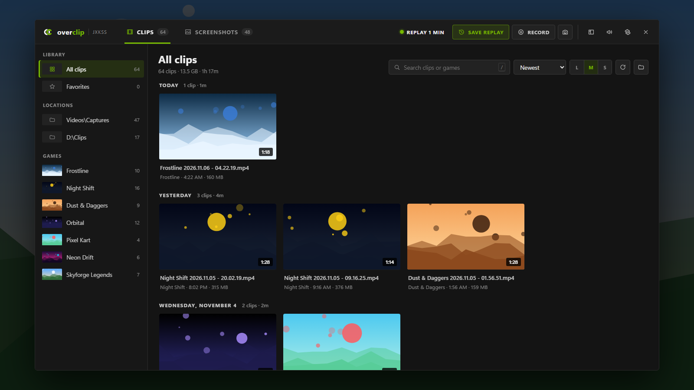
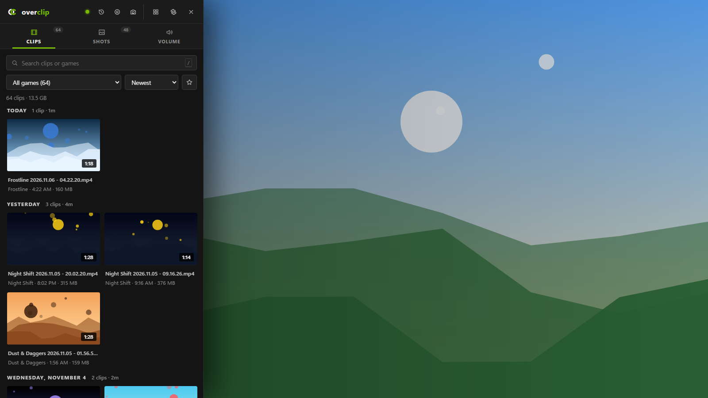
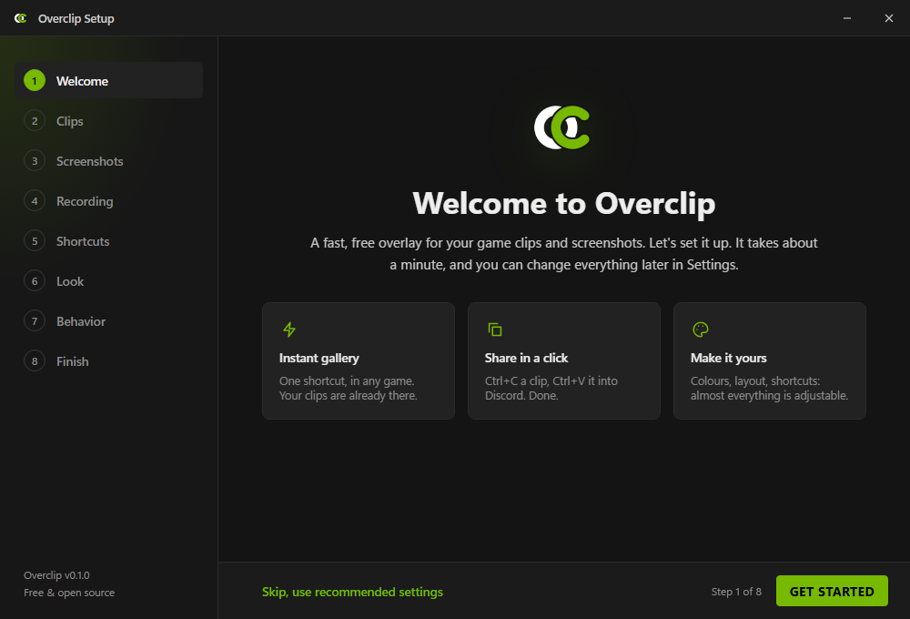

<div align="center">


# Overclip

**Your game clips and screenshots, one shortcut away.**

A free, open-source in-game overlay for Windows. Press a key in any game to browse, preview,
share and tidy up everything your recorder saves — without alt-tabbing.

[Download](https://github.com/Jxkss/overclip/releases/latest) ·
[Website](https://overclip.jxks.dev/) ·
[Report a bug](https://github.com/Jxkss/overclip/issues/new/choose)


[](https://github.com/Jxkss/overclip/releases/latest)



</div>

## Features

- **Instant overlay.** <kbd>Ctrl</kbd>+<kbd>Alt</kbd>+<kbd>P</kbd> opens the full gallery,
  <kbd>Ctrl</kbd>+<kbd>P</kbd> a slim side panel. Both shortcuts are yours to change.
- **Works with the recorder you already use.** Xbox Game Bar, AMD ReLive, NVIDIA ShadowPlay /
  NVIDIA App, OBS, Medal, Outplayed, ShareX, Windows screenshots — Overclip finds their folders for you.
- **Drives your recorder too.** Save replay, Record and Screenshot buttons right in the overlay.
  AMD Software, Xbox Game Bar and OBS Studio also get their recording settings (replay length,
  quality, frame rate, audio, save folder) inside Overclip; NVIDIA App and Medal are driven
  through their own shortcuts. Overclip never records anything itself.
- **Organised automatically.** Clips are grouped by game and by day, with each game's latest
  clip as its cover. Search, favourites, sort by length or size.
- **Share in one keystroke.** <kbd>Ctrl</kbd>+<kbd>C</kbd> copies the actual file, so
  <kbd>Ctrl</kbd>+<kbd>V</kbd> uploads it straight into Discord or a browser.
- **Fast with huge libraries.** Thumbnails come from Windows' own thumbnail cache and are
  generated in the background at low priority; thousands of files scroll smoothly.
- **Multiple folders and drives.** Add an external drive; it's only touched while the overlay
  is open, so it can still be safely ejected.
- **Safe by default.** Deleting moves files to the Recycle Bin, with a confirmation you can turn off.
- **Make it yours.** Accent colour, OLED-black theme, interface size, background dimming,
  layout, panel side and width, animations, hover previews and more — every setting applies instantly.
- **Volume mixer** for every app that's playing sound.
- **Private.** No account, no telemetry, no uploads. Everything stays on your PC.

<p align="center">
  
  
</p>

## Recording

Settings → Recording → **Your recorder** picks which app the overlay's buttons drive
(Automatic picks the one on your PC).

| Recorder | Settings in Overclip | Save replay · Record · Screenshot |
|---|---|---|
| AMD Software (Adrenalin) | Instant Replay, length, folder, resolution, frame rate, bitrate, codec, audio, stereo/7.1 | ✅ via AMD's own command-line tool |
| Xbox Game Bar | Background recording, length, longest recording, frame rate, quality, audio, folder | ✅ presses Game Bar's shortcuts |
| OBS Studio | Replay buffer on/off and length, frame rate, quality, folder | ✅ via OBS's built-in remote control |
| NVIDIA App | — (NVIDIA doesn't allow it) | ✅ presses its shortcuts (Alt+F10 / F9 / F1 by default) |
| Medal | — | Save clip (F8 by default) |

Changing a replay setting restarts that recorder's replay buffer, just like changing it in the
recorder's own app. For OBS, Overclip reads the WebSocket port and password from OBS's own
settings; if remote control is off, Settings → Recording can turn it on while OBS is closed.

> **Clips with no sound in Windows' Photos or Media Player?** They were probably recorded with
> 7.1 surround audio (surround headsets, SteelSeries Sonar…), which Windows' own apps can't decode.
> With AMD Software, set Settings → Recording → Audio channels to **Stereo**.

## Install

1. Download `Overclip_x.y.z_x64-setup.exe` from the
   [latest release](https://github.com/Jxkss/overclip/releases/latest).
2. Run it. No admin rights needed; it installs for your user only.
3. The **setup wizard** opens: pick your clip and screenshot folders (detected for you),
   your shortcuts, colours and behaviour. You can re-run it any time from Settings → System.

Overclip then lives in the system tray. Press your shortcut in any game.

> **Fullscreen games:** like every overlay, Overclip shows on top of *borderless/windowed*
> fullscreen. Games running in exclusive fullscreen may minimise when it opens.

## Keyboard shortcuts

| Keys | Action |
| --- | --- |
| <kbd>Ctrl</kbd>+<kbd>Alt</kbd>+<kbd>P</kbd> / <kbd>Ctrl</kbd>+<kbd>P</kbd> | Full gallery / side panel (customisable) |
| <kbd>?</kbd> | Show all shortcuts |
| Just type, or <kbd>/</kbd> | Search |
| Arrows, <kbd>Enter</kbd> | Move, preview (<kbd>←</kbd> <kbd>→</kbd> to step through) |
| <kbd>Ctrl</kbd>+<kbd>C</kbd> | Copy the file(s) — paste into Discord |
| <kbd>F</kbd> · <kbd>O</kbd> · <kbd>E</kbd> · <kbd>F2</kbd> | Favourite · open in player · show in Explorer · rename |
| <kbd>Del</kbd> | Move to Recycle Bin |

## FAQ

**Does Overclip record clips?** No. It's the viewer for whatever your recorder already saves.

**Is it safe with anti-cheat?** Overclip never touches game processes; it's an ordinary
always-on-top window, like Discord's or Steam's overlays.

**Where are my settings?** `%APPDATA%\com.overclip.app\settings.json`. Thumbnails are cached in
`%LOCALAPPDATA%\com.overclip.app`.

## Building from source

Requirements: Windows 10/11, [Node.js](https://nodejs.org) 20+, [Rust](https://rustup.rs)
(stable, MSVC toolchain), and the WebView2 runtime (preinstalled on Windows 11).

```bash
npm install
npm run tauri dev     # run the app with hot reload
npm run tauri build   # build the installer into src-tauri/target/release/bundle/nsis
```

**UI-only development:** `npm run dev`, then open <http://localhost:1420> in any browser. Without
the Tauri backend the UI runs against built-in demo data (`src/dev/demo.tsx`), so you can work on
the interface on any OS.

### Project layout

| Path | What |
| --- | --- |
| `src/` | React + TypeScript UI (overlay, side panel, settings, setup wizard) |
| `src/dev/demo.tsx` | Fake backend for browser development and screenshots |
| `src-tauri/src/` | Rust backend: folder scanning, thumbnails, hotkeys, audio, settings, recorder control (`amd.rs`, `gamebar.rs`, `obs.rs`, `recorder.rs`) |
| `src-tauri/installer/` | Installer artwork and NSIS hooks |
| `website/` | The project website (static, deployed to GitHub Pages) |

## Publishing

- **Website:** the `Website` workflow publishes `website/` to GitHub Pages on every push to `main`.
  Turn it on once under Settings → Pages → Build and deployment → Source: **GitHub Actions**.
  The site is served at <https://overclip.jxks.dev> (custom domain set under Settings → Pages).
- **Releases:** push a tag like `v0.1.0` (`git tag v0.1.0 && git push origin v0.1.0`). The `Release`
  workflow builds the installer and opens a draft release with it attached; review and publish it.

## Contributing

Bug reports, ideas and pull requests are welcome — see [CONTRIBUTING.md](CONTRIBUTING.md).

## License

[MIT](LICENSE) © Jxkss

Overclip is an independent project and is not affiliated with NVIDIA, AMD, Microsoft or any game
or recording-software vendor. Product names are used only to describe compatibility.
